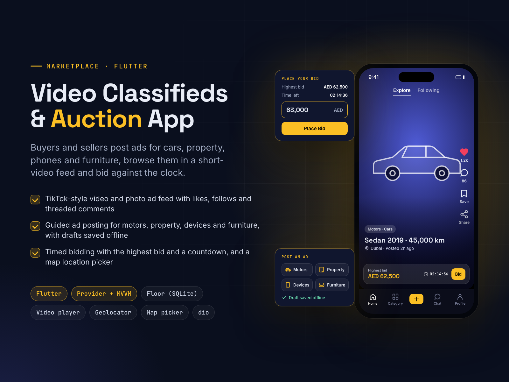

# Video Classifieds & Auction Marketplace App

**Flutter**

**Goal:** a marketplace where cars, property, phones and furniture are sold through short videos and timed bidding.

**Solution:** a Flutter app with a TikTok-style feed of video and photo ads (Explore and Following), likes, follows and threaded comments. Sellers post through guided forms for each category, with drafts saved offline in SQLite and a map location picker. Buyers bid on ads that show the highest bid and a countdown. Built with Provider + MVVM, get_it and dio.

**Result:** browsing, selling and bidding in one video-first app.

| | |
|---|---|
| **My role** | Lead Flutter developer |
| **Skills** | Flutter, Mobile App Development, Map Integration, Android App Development, iOS Development |

## About this repository

This is a showcase repository. It contains the project poster and the poster's own HTML/CSS source in [`poster/`](poster/).
The app was built for a client, so its source code and the client's name are not public.

To re-render the poster, open `poster/index.html` in Chrome at 1600×1200, or run `poster/render.sh` on macOS.

More of my work: **https://ahsanrazapk.github.io**
